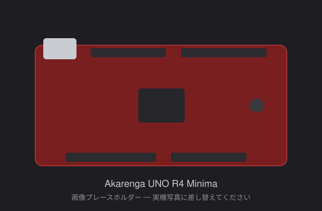

# Akarenga UNO R4 Minima

Arduino UNO R4 Minima 互換のオープンソースハードウェアボードです。

> **TODO:** 冒頭に 2〜3 行の紹介文を書く。搭載 MCU (RA4M1 など)、想定用途、Akarenga OSHW プロジェクトにおける位置づけに触れる。

[Getting Started を読む](tutorials/getting-started/index.md)

> **TODO:** 上の画像はプレースホルダーです。実機の写真を `board.jpg` として配置し、参照先を差し替えてください。

## 特長

> **TODO:** UNO R4 Minima との違い (外部水晶振動子の搭載など) を中心に、箇条書きで記載する。

## Tech Specs

| 項目 | 内容 |
|---|---|
| マイクロコントローラ | TODO |
| 動作電圧 | TODO |
| 入力電圧 (VIN) | TODO |
| クロック | TODO |
| メモリ | TODO |
| デジタル I/O ピン | TODO |
| アナログ入力ピン | TODO |
| 通信 | TODO |
| USB | TODO |
| 外形寸法 | TODO |

## ダウンロード

オープンソースハードウェアとして設計データを公開しています。

> **TODO:** 以下のファイルを用意して `downloads/` に配置し、リンクを有効にする。

- 回路図 (PDF)
- 基板データ / ガーバー
- 部品表 (BOM)
- ピンアウト図 (PDF)

ライセンスは CERN OHL を予定しています。

> **TODO:** 適用するライセンスのバージョン (CERN-OHL-S / -W / -P) を確定して明記する。

## ドキュメント

- [Getting Started](tutorials/getting-started/index.md) — 開発環境のセットアップと動作確認
