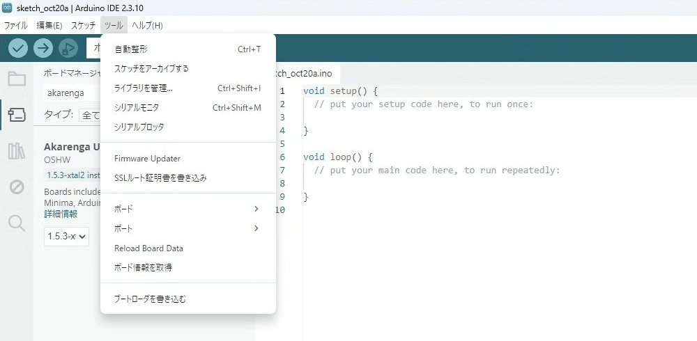
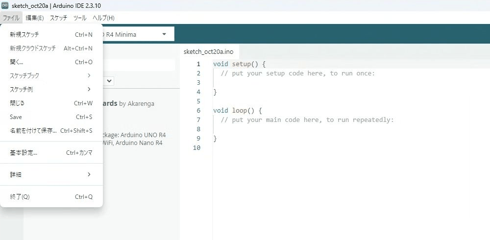

# Akarenga UNO 導入手順

Arduino IDEを使い、Akarenga UNOの開発環境を導入して、LED点滅（Blink）とシリアル通信を確認するまでの手順です。

> ボードパッケージ：`Akarenga UNO R4 Boards 1.5.3-xtal2`  
> ボード名（IDEでの表示）：`Arduino UNO R4 Minima`（`Akarenga UNO R4 Boards`内）

## 1. この手順でできること

この手順を最後まで行うと、次の状態になります。

- Arduino IDEからAkarenga UNOを選択できる
- Akarenga UNO用のスケッチをコンパイルして書き込める
- ボード上のLEDを1秒間隔で点滅させられる
- シリアルモニターでAkarenga UNOからの文字を確認できる

Akarenga用ボードパッケージには、12 MHzメイン水晶と32.768 kHz RTC水晶を使うためのCoreが含まれます。通常の利用者が水晶用のソースコードや設定ファイルを書き換える必要はありません。

## 2. 必要なもの

- Akarenga UNO本体
- Akarenga UNOとパソコンを接続できるUSBデータ通信対応TypeCケーブル
- Windows 10以降、macOS 10.15以降、または64ビットLinuxのパソコン
- インターネット接続
- Arduino IDE 2


## 3. Arduino IDE 2をインストールする

1. [Arduino公式ダウンロードページ](https://www.arduino.cc/en/software/)を開きます。
2. 使用しているOSに合ったArduino IDE 2の安定版をダウンロードします。
3. ダウンロードしたファイルを開き、画面の案内に従ってインストールします。
4. Arduino IDEを起動します。

OSごとの基本操作は次のとおりです。

| OS | インストール方法 |
|---|---|
| Windows | `.exe`を実行し、インストーラーの案内に従う |
| macOS | `.dmg`を開き、Arduino IDEを「アプリケーション」へ移動する |
| Linux | AppImageに実行権限を付けて起動する |

この手順書ではArduino IDE 2を使用します。IDE 1.8.19はLegacy版のため、画面やメニューの位置が異なります。

操作GIFはWindows 11・Arduino IDE 2.3.10の画面です。GIFをクリックすると元のサイズで表示できます。

## 4. 公式のArduino UNO R4 Boardsをインストールする

現在のAkarenga開発版は、コンパイラなどのツールチェーンをArduino公式パッケージから利用します。先に公式のUNO R4用パッケージをインストールしてください。

1. Arduino IDE左側の**ボードマネージャー**アイコンをクリックします。
2. 検索欄に次を入力します。

    ```text
    Arduino UNO R4 Boards
    ```

3. Arduino公式の`Arduino UNO R4 Boards`を選び、**インストール**をクリックします。
4. インストール完了の表示を確認します。

## 5. AkarengaのボードマネージャーURLを登録する

### 5.1 設定画面を開く

- Windows／Linux：**ファイル → 基本設定**
- macOS：**Arduino IDE → 設定**

### 5.2 URLを追加する

1. **追加のボードマネージャーのURL**を探します。
2. 入力欄の右側にあるボタンを押し、URL一覧を開きます。
3. 次のURLを1行で貼り付けます。

    ```text
    https://akarenga-oshw.github.io/arduino-board-index/dev/package_akarenga_index.json
    ```

4. すでに別のURLが登録されている場合は削除せず、新しい行へ追加します。
5. **OK**を押してURL一覧を閉じ、もう一度**OK**を押して設定を保存します。


## 6. Akarenga用ボードパッケージをインストールする

1. Arduino IDE左側の**ボードマネージャー**を開きます。
2. 検索欄に次を入力します。

    ```text
    Akarenga
    ```

3. `Akarenga UNO R4 Boards`を選びます。
4. バージョン欄を確認し、**インストール**をクリックします。
5. インストール完了の表示を確認します。

2026年7月24日時点の開発版では、表示バージョンは`1.5.3-xtal2`です。今後バージョンが更新された場合は、プロジェクトから特別な指定がない限り新しい安定版を使用し、実際に使ったバージョンを記録してください。

## 7. ボードとポートを選択する

1. Akarenga UNOをUSBケーブルでパソコンに接続します。
2. Arduino IDE上部の**ツール → ボード**を開きます。
3. **Akarenga UNO R4 Boards → Arduino UNO R4 Minima**を選びます。
4. Akarenga UNOに対応するポートを**ツール → ポート**から選びます。

ボード名は`Arduino UNO R4 Minima`と表示されます。必ず**Akarenga UNO R4 Boards**内から選んでください。

<p><a href="assets/board-selection.gif"></a></p>

ポート名の例は次のとおりです。実際の表示は環境により異なります。

| OS | ポート名の例 |
|---|---|
| Windows | `COM3`、`COM4` |
| macOS | `/dev/cu.usbmodem...` |
| Linux | `/dev/ttyACM0` |


## 8. Blinkを書き込む

### 8.1 サンプルを開く

Arduino IDEのメニューから、次を選びます。
`ファイル > スケッチ例 > 01.Basics > Blink`

<p><a href="assets/open-blink.gif"></a></p>

次の内容と同様のスケッチが開きます。

```cpp
void setup() {
  pinMode(LED_BUILTIN, OUTPUT);
}

void loop() {
  digitalWrite(LED_BUILTIN, HIGH);
  delay(1000);
  digitalWrite(LED_BUILTIN, LOW);
  delay(1000);
}
```

### 8.2 書き込む

1. **Akarenga UNO R4 Boards**内の`Arduino UNO R4 Minima`を選択していることを確認します。
2. 選択中のポートを確認します。
3. Arduino IDE左上の**書き込み**ボタン（右向き矢印）をクリックします。
4. 画面下部に書き込み完了の表示が出るまで待ちます。
5. ボード上の内蔵LEDが約1秒ごとに点灯・消灯することを確認します。

LEDが点滅すれば、コンパイル、USB書き込み、メインクロック、基本的なArduino関数が動作しています。

## 9. シリアルモニターを確認する

新しいスケッチへ次を貼り付けます。

```cpp
void setup() {
  Serial.begin(115200);

  unsigned long start = millis();
  while (!Serial && millis() - start < 5000) {
    // シリアル接続を最大5秒待つ
  }

  Serial.println("Akarenga UNO serial test");
}

void loop() {
  Serial.print("millis = ");
  Serial.println(millis());
  delay(1000);
}
```

1. スケッチを書き込みます。
2. Arduino IDE上部の**ツール → シリアルモニタ**を開きます。
3. 通信速度を`115200 baud`に設定します。
4. `millis = ...`が約1秒ごとに表示されることを確認します。

最初の`Akarenga UNO serial test`が見えない場合でも、`millis`の値が増え続けていればシリアル通信は正常です。シリアルモニターを開いたまま再起動すると、最初の行も確認しやすくなります。

## 10. 参考リンク

- [Akarenga OSHW ドキュメント](https://akarenga-oshw.github.io/)
- [Akarenga開発版ボードマネージャーJSON](https://akarenga-oshw.github.io/arduino-board-index/dev/package_akarenga_index.json)
- [Arduino IDEのダウンロードとインストール](https://support.arduino.cc/hc/en-us/articles/360019833020-Download-and-install-Arduino-IDE)
- [追加のボードマネージャーURLを登録する方法](https://support.arduino.cc/hc/en-us/articles/360016466340-Add-third-party-platforms-to-the-Boards-Manager-in-Arduino-IDE)
- [Arduino IDE 2でボードパッケージをインストールする方法](https://docs.arduino.cc/software/ide-v2/tutorials/ide-v2-board-manager/)

---
